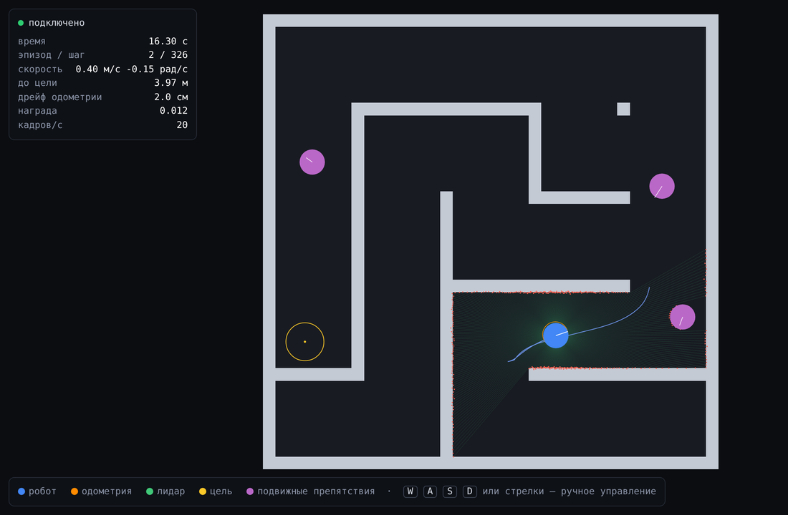
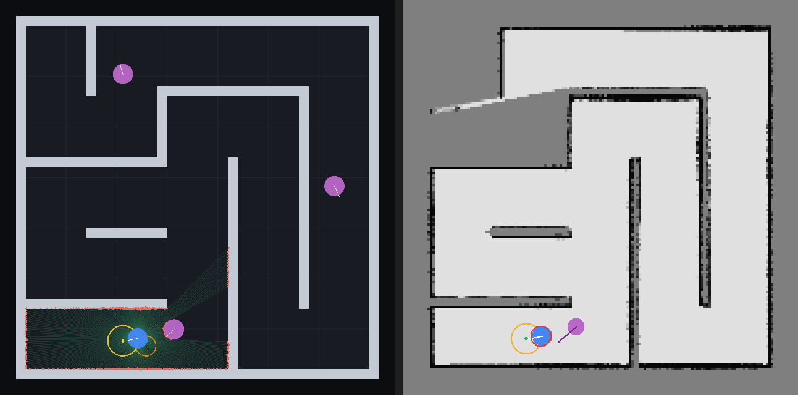

# roversim

Лёгкий детерминированный симулятор колёсного ровера с дифференциальным приводом
для отработки автономной навигации и обучения с подкреплением. Ядро написано на
C++20, управляется из Python (pybind11) и не имеет внешних зависимостей.

В проекте две части:

1. **Ядро симуляции** — динамика привода с трением и инерцией, столкновения,
   2D-лидар, IMU, одометрия, подвижные препятствия, обмен через разделяемую
   память, визуализация.
2. **Автономность** — сеточный SLAM, глобальный планировщик (A* / Theta*),
   локальный планировщик DWA с прогнозом движения препятствий и обучение
   политики методом PPO.

Математическое обоснование всех моделей и алгоритмов —
в [docs/TECHNICAL.md](docs/TECHNICAL.md).



## Что получилось в цифрах

Измерено на 4 ядрах x86-64 программами из этого репозитория: `roversim_bench`
(ядро), `roversim_nav_bench` (навигация), `rl/evaluate.py` (политика). Симуляция
детерминирована, поэтому показатели качества при повторном запуске совпадают до
последнего знака; от машины зависят только времена.

| Показатель | Значение |
| --- | --- |
| Шаг симуляции, 360 лучей лидара, 10 шагов физики | 51 мкс (19.6 тыс. шагов/с, ×980 реального времени) |
| То же, 90 лучей | 21 мкс (46.8 тыс. шагов/с) |
| Пакет из 256 сред, 4 потока | 56.9 тыс. шагов/с |
| Накладные расходы разделяемой памяти на шаг (непрерывный обмен) | 0.5 мкс |
| Навигация в неизвестном лабиринте (SLAM + Theta* + DWA), 200 эпизодов | 200/200 целей, ни одного касания, SPL 0.94 |
| Ошибка позы: SLAM против чистой одометрии | 2.2 см против 18.8 см |
| Навигация с подвижными препятствиями, 800 эпизодов в четырёх сценах | 798/800 целей; без единого касания 85 % эпизодов (от 96 % на арене до 66 % в тесном лабиринте) |
| Политика PPO на 1000 эпизодах в новых лабиринтах | 99.9 % целей, 0.0 % столкновений |
| Обучение PPO до этого уровня | 4 млн шагов, 9 минут на CPU |
| Тесты | 39 на C++ и 17 на Python |

## Сборка

Нужны компилятор с поддержкой C++20 (GCC ≥ 11 или Clang ≥ 14), CMake ≥ 3.20 и,
для Python-модуля, Python ≥ 3.9 с NumPy и pybind11. Платформа — Linux (на macOS
ожидание в разделяемой памяти идёт через опрос вместо futex).

```bash
pip install numpy pybind11 gymnasium pytest pillow      # torch — для обучения PPO
```

```bash
cmake -S . -B build -G Ninja
```

```bash
cmake --build build
```

```bash
ctest --test-dir build --output-on-failure
```

После сборки в `build/` лежат `roversim_server`, `roversim_bench`,
`roversim_nav_bench`, `roversim_tests`, а в `build/python` — готовый к импорту пакет:

```bash
PYTHONPATH=build/python python examples/01_quickstart.py
```

Вместо этого пакет можно установить (сборка через scikit-build-core):

```bash
pip install .
```

Параметры CMake: `ROVERSIM_BUILD_PYTHON`, `ROVERSIM_BUILD_APPS`,
`ROVERSIM_BUILD_TESTS` (все включены) и `ROVERSIM_NATIVE` (`-march=native`, выключен).

## Быстрый старт

```python
import roversim as rs

world = rs.World.maze(cols=5, rows=5, corridor=1.2, seed=1, loop_prob=0.15)
config = rs.make_config({"lidar.num_rays": 360, "obstacles.count": 2})
sim = rs.Simulator(config, world)

sim.reset(seed=42)                    # случайные старт и цель, заданные seed
result = sim.step(10.0, 12.0)         # уставки угловых скоростей колёс, рад/с
scan = sim.lidar                      # numpy float32 [360] — вид без копирования
imu_odom_goal = sim.proprio           # float32 [15], индексы — rs.obs.*
truth = sim.state                     # float64 [12], индексы — rs.gt.*
print(result.reward, result.collision, scan.min(), truth[rs.gt.X])
```

`sim.lidar`, `sim.proprio` и `sim.state` — массивы NumPy, которые смотрят прямо
в память симулятора: они не копируются, защищены от записи, а их содержимое
обновляется при каждом `reset()` и `step()`.

### Среда Gymnasium

```python
import numpy as np
import roversim as rs

env = rs.RoverEnv("maze", {"lidar.num_rays": 180}, render_mode="rgb_array")
observation, info = env.reset(seed=0)
for _ in range(200):
    action = np.array([0.5, 0.0], dtype=np.float32)   # (линейная, угловая) скорость в долях максимума
    observation, reward, terminated, truncated, info = env.step(action)
    if terminated or truncated:
        observation, info = env.reset()
frame = env.render()                                   # uint8 [512, 512, 3]
```

Среда зарегистрирована как `roversim/Nav-v0` и проходит проверку
`gymnasium.utils.env_checker.check_env`. Наблюдения по умолчанию — независимые
копии; `zero_copy=True` отдаёт виды на память симулятора.

### Пакет сред для обучения

```python
import torch
import roversim as rs

env = rs.RoverVecEnv(256, world="maze", num_worlds=64, config={"lidar.num_rays": 90})
obs, _ = env.reset(seed=0)
lidar = torch.from_numpy(obs["lidar"])        # тензор [256, 90] поверх памяти симулятора
obs, reward, terminated, truncated, info = env.step(torch.zeros(256, 2).numpy())
```

Среды шагают параллельно в потоках ядра, завершившиеся эпизоды перезапускаются
сами. Результат не зависит от числа потоков. Массивы наблюдений защищены от
записи, поэтому `torch.from_numpy` один раз предупредит о тензоре только для
чтения — так и задумано: память принадлежит симулятору.

### Симулятор в отдельном процессе

```bash
./build/roversim_server --shm /roversim --world maze --viz web
```

```python
import roversim as rs

client = rs.ShmClient("/roversim")
client.reset(7)
result = client.step(10.0, 10.0)      # запрос — ответ через разделяемую память
scan = client.lidar                   # массив NumPy прямо поверх сегмента
```

Ту же связь использует `rs.RoverEnv(shm_name="/roversim")`. Раскладка сегмента
описана в [core/include/roversim/shm.hpp](core/include/roversim/shm.hpp); по ней
к симулятору можно подключиться из любого языка.

Обе стороны ждут друг друга активно 200 мкс и только потом засыпают, поэтому при
непрерывном обмене транспорт добавляет к шагу 0.5 мкс. Если клиент между шагами
занят дольше (например, считает нейросеть), сервер успевает уснуть, и его
пробуждение стоит около 40 мкс. Когда это важно, время активного ожидания
увеличивают — `roversim_server --spin-us 5000` или `server.spin_time = 5e-3` —
ценой полностью занятого ядра процессора.

## Автономная навигация и SLAM

```python
import roversim as rs

sim = rs.Simulator(rs.make_config({"task.max_steps": 4000, "obstacles.count": 3}), rs.make_world("maze", 101))
sim.reset(seed=1)

agent = rs.NavigationAgent(sim)       # SLAM + Theta* + DWA; истинную позу и карту не использует
agent.set_goal(*sim.goal)
while True:
    result = sim.step(*agent.act())
    if result.terminated or result.truncated:
        break

navigator = agent.navigator
print(navigator.pose, sim.pose)                       # оценка SLAM и истинная поза
picture = rs.render_navigation(navigator, truth_pose=sim.pose)   # карта, маршрут, объекты
```



*Слева — истинный мир, справа — карта, построенная роботом по лидару и одометрии:
серое не разведано, синий круг — оценка позы, красное кольцо — истинная поза,
фиолетовый круг со стрелкой — сопровождаемое подвижное препятствие и его скорость.*

Навигатору нужны только скан лидара и одометрия, поэтому он одинаково работает
внутри процесса и через разделяемую память (`examples/02_shm_client.py`). Его
части доступны и по отдельности: `rs.nav.OccupancyGrid`, `rs.nav.GridSlam`,
`rs.nav.GridPlanner`, `rs.nav.DwaPlanner`.

| Сценарий (200 эпизодов, карта заранее не известна) | Цель достигнута | Без касаний | SPL |
| --- | --- | --- | --- |
| Лабиринт, проходы 1.2 м | 200/200 | 200/200 | 0.94 |
| То же, A* со спрямлением вместо Theta* | 200/200 | 200/200 | 0.95 |
| То же, без сопоставления сканов (карта по одометрии) | 156/200 | 156/200 | 0.74 |
| Арена с препятствиями + 5 подвижных | 200/200 | 193/200 | — |
| Лабиринт, проходы 1.8 м + 4 подвижных | 200/200 | 184/200 | — |
| Лабиринт, проходы 1.2 м + 2 подвижных | 200/200 | 168/200 | — |
| Лабиринт, проходы 1.2 м + 4 подвижных | 198/200 | 133/200 | — |

В проходе шириной 1.2 м роботу и препятствию (оба диаметром 0.4 м) остаётся на
двоих 0.2 м зазора, а препятствия дорогу не уступают, поэтому разойтись удаётся
не всегда. Из 216 зафиксированных касаний в 214 робот стоял или отъезжал — в
него въезжало препятствие, которое он видел и сопровождал; стен робот не
коснулся ни разу.

Таблица воспроизводится командой (около 10 минут; без ключа — первые 50
эпизодов каждого сценария за 2.5 минуты):

```bash
./build/roversim_nav_bench --episodes 200
```

Та же программа сравнивает варианты стека (`--hit-memory`, `--confirm-travel`,
`--startup-time`); результаты и выводы — в разделе 10.2 технического описания.

## Обучение с подкреплением

```bash
PYTHONPATH=build/python python rl/train_ppo.py --total-steps 4000000 --save models/ppo_rover.pt
```

```bash
PYTHONPATH=build/python python rl/evaluate.py models/ppo_rover.pt --episodes 1000
```

```bash
PYTHONPATH=build/python python rl/evaluate.py models/ppo_rover.pt --web
```

Агент видит скан лидара (90 лучей), скорости по одометрии, направление на цель и
направление, в котором к цели ведёт кратчайший путь; управляет линейной и угловой
скоростью. Обучение идёт на 256 параллельных средах в 64 случайных лабиринтах,
проверка — на лабиринтах, которых в обучении не было.

| Модель | Условия проверки (1000 эпизодов, новые лабиринты) | Цель | Столкновение | Не успел |
| --- | --- | --- | --- | --- |
| `models/ppo_rover.pt` | статичные лабиринты | 99.9 % | 0.0 % | 0.1 % |
| `models/ppo_rover.pt` | + 2 подвижных препятствия (в обучении их не было) | 71.6 % | 28.3 % | 0.1 % |
| `models/ppo_rover_dynamic.pt` | + 2 подвижных препятствия (обучена с ними) | 78.9 % | 19.6 % | 1.5 % |
| `models/ppo_rover_dynamic.pt` | статичные лабиринты | 97.7 % | 0.0 % | 2.3 % |

Задача из постановки — случайные лабиринты без столкновений — решена первой
моделью. Вторая показывает предел выбранной архитектуры: политика без памяти
видит один скан и не может оценить скорость объекта, поэтому обучение с
подвижными препятствиями снижает долю столкновений лишь с 28 % до 20 %
(разбор — в разделе 9.3 технического описания).

Обе модели лежат в `models/`. Подробности постановки, архитектуры сети и
гиперпараметры — в разделе 9 технического описания.

## Визуализация

Без дополнительных действий симулятор работает в headless-режиме. Для отладки
есть три способа посмотреть на происходящее:

* **Браузер.** `rs.WebViewer(8765)` и `viewer.publish(sim)` после каждого шага,
  либо `RoverEnv(render_mode="web")`, либо `roversim_server --viz web`. Сервер
  встроен в ядро (HTTP + WebSocket, без зависимостей) и слушает только
  `127.0.0.1`. Клавиши W/A/S/D или стрелки — ручное управление.
* **Терминал.** `roversim_server --viz tui` или `RoverEnv(render_mode="ansi")`:
  кадр из цветных полублоков, работает по SSH.
* **Кадр в массив.** `rs.Renderer(w, h).render(sim)` или
  `RoverEnv(render_mode="rgb_array")` — для записи видео и сохранения картинок.

Демонстрация без клиента — робот сам ездит по случайным целям в реальном времени:

```bash
./build/roversim_server --demo --driver nav --obstacles 3 --viz web
```

`--driver nav` — полный автономный контур по лидару и одометрии; `--driver pursuit`
(по умолчанию) — следование по истинному кратчайшему пути.

## Примеры

| Файл | Что показывает |
| --- | --- |
| `examples/01_quickstart.py` | среда Gymnasium, чтение лидара, простой реактивный регулятор |
| `examples/02_shm_client.py` | запуск `roversim_server` и управление через разделяемую память |
| `examples/03_vec_rollout.py` | пакет из сотен сред, тензоры PyTorch без копирования, скорость |
| `examples/04_slam_navigation.py` | SLAM и навигация в неизвестном лабиринте с подвижными препятствиями |
| `rl/train_ppo.py`, `rl/evaluate.py` | обучение и проверка политики PPO |

## Устройство проекта

```
core/include/roversim/        заголовки ядра
    math.hpp  rng.hpp         векторы, позы; детерминированный ГСЧ
    world.hpp                 сетка занятости, препятствия, трассировка лучей, столкновения
    navgrid.hpp               проходимость и кратчайшие пути по истинной карте (награда, SPL)
    robot.hpp                 динамика дифференциального привода
    sensors.hpp               лидар, IMU, одометрия
    simulator.hpp             симулятор: reset / step / наблюдения, подвижные препятствия
    vec_simulator.hpp         пакет сред в пуле потоков
    shm.hpp                   сервер и клиент разделяемой памяти
    viz.hpp                   растеризатор, терминал, веб-просмотрщик
    nav/occupancy_grid.hpp    карта занятости: лог-шансы, алгоритм Брезенхема
    nav/slam.hpp              сопоставление сканов и сеточный SLAM
    nav/planner.hpp           карта стоимости, A*, Theta*
    nav/tracker.hpp           сопровождение подвижных объектов
    nav/dwa.hpp               локальный планировщик DWA
    nav/navigator.hpp         контур навигации целиком
core/src/                     реализация
python/bindings.cpp           биндинги pybind11 (модуль roversim._core)
python/roversim/              пакет Python: RoverEnv, RoverVecEnv, NavigationAgent
apps/                         roversim_server, roversim_bench, roversim_nav_bench
rl/                           модель, обучение PPO, оценка
examples/                     примеры
tests/                        тесты ядра (C++) и Python-интерфейса
web/viewer.html               страница веб-просмотрщика (встраивается в бинарник)
docs/TECHNICAL.md             техническое описание и математика
models/                       обученные политики
```

## Конфигурация

Все параметры собраны в `SimConfig`; любое поле задаётся путём через точку:
`rs.make_config({"robot.mass": 8.0, "lidar.noise_std": 0.02})`. Опечатка в имени
поля — ошибка, а не молча проигнорированная настройка.

| Раздел | Что задаёт |
| --- | --- |
| `physics_dt`, `substeps` | шаг физики (5 мс) и число шагов на `step()` (10) → период управления 50 мс |
| `robot.*` | радиус, масса, моменты инерции, жёсткость и предельный момент привода, коэффициенты трения |
| `lidar.*` | число лучей, угол обзора, дальность, шум, потери отражений, квантование, место установки |
| `imu.*` | спектральные плотности шума и блуждания смещений гироскопа и акселерометра |
| `odom.*` | разрешение энкодеров, шум, ошибки калибровки радиуса колёс и колеи |
| `task.*` | радиус цели, лимит шагов, завершение по столкновению, веса награды, подсказка маршрута |
| `obstacles.*` | число, радиус и диапазон скоростей подвижных препятствий |

## Детерминизм

При одинаковых конфигурации, мире, seed и действиях траектория и показания
сенсоров совпадают бит в бит — в одном процессе, через разделяемую память и в
пакете сред при любом числе потоков (всё это проверяется тестами). Для этого:
фиксированный шаг по времени, собственный ГСЧ с отдельным потоком на каждый
источник шума, запрет слияния операций в FMA (`-ffp-contract=off`), отсутствие
`-ffast-math` и обращений к часам. Между разными платформами возможны
расхождения в последнем разряде из-за реализаций `sin`, `cos`, `log` в libm.

## Ограничения

* Робот — круг с центром масс в середине ведущей оси; мир плоский.
* Стены без трения; распределение веса по колёсам постоянно.
* SLAM — без замыкания циклов: на длинных маршрутах по новой территории ошибка
  медленно растёт (в освоенной местности поза привязана к карте). Карта
  фиксированного размера: по умолчанию 20 × 20 м с центром в точке старта, цель
  за её пределами `set_goal` отклоняет.
* Трекер подвижных объектов рассчитан на компактные объекты (до 1 м) в уже
  разведанном свободном пространстве: в первую секунду после включения он не
  отличает едущий навстречу объект от стены.
* Подвижные препятствия не уступают дорогу; в тесном лабиринте с четырьмя
  препятствиями без единого касания проходят две трети эпизодов.
* Политика PPO реактивна (без памяти) и опирается на подсказку маршрута; без
  неё (`task.path_hint = false`) задача в лабиринте требует памяти.
* Разделяемая память: один управляющий клиент на сегмент; Linux и macOS.
